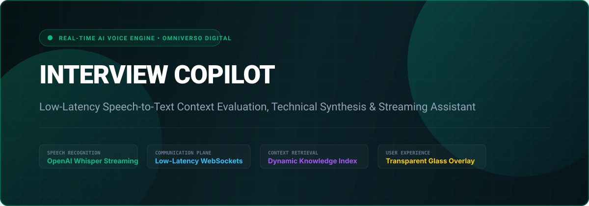
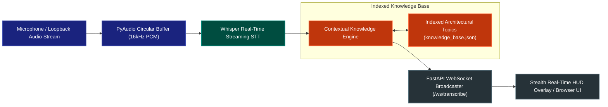

<p align="center">
  
</p>

# 🎙️ Interview Copilot Suite
### Low-Latency Streaming Audio Transcription, Knowledge Retrieval & Technical Assistant

[](https://fastapi.tiangolo.com/)
[](https://websockets.readthedocs.io/)
[](https://python.org)
[](https://github.com/openai/whisper)
[](https://github.com/omniversodigital/interview-copilot)
[](LICENSE)

**Interview Copilot Suite** is a low-latency, real-time AI assistant and speech-to-text transcription engine. It captures system loopback audio, transcribes live speech, evaluates conversation context, and retrieves verified architectural concepts in sub-second inference cycles.

---

## 🏛️ System Architecture



---

## ⚡ Core Capabilities

- **Sub-500ms Speech Ingestion**: Streaming circular buffer with voice activity detection (VAD) minimizes speech turnaround time.
- **Semantic Domain Matching**: Real-time evaluation against a curated knowledge base covering systems design, distributed consensus, policy latency, and microservices architecture.
- **Stealth Floating HUD**: Low-memory GUI overlay rendered over active coding environments with minimal window-switching friction.
- **WebSocket Event Bus**: Full bi-directional streaming protocol supporting multiple simultaneous subscriber interfaces.

---

## 📡 API Specification

| Endpoint | Method | Description |
| :--- | :---: | :--- |
| `/` | `GET` | Serves the glassmorphic real-time Copilot console interface |
| `/api/topics` | `GET` | Returns all pre-indexed technical system architecture topics |
| `/api/query` | `POST` | Performs semantic question matching with confidence scoring |
| `/ws/transcribe` | `WS` | Streaming WebSocket for real-time speech packets and AI responses |

---

## 🛠️ Quickstart Guide

### 1. Installation
```bash
git clone https://github.com/omniversodigital/interview-copilot.git
cd interview-copilot

pip install -r requirements.txt || uv pip install -r requirements.txt
```

### 2. Launch the Copilot Server
```bash
python server.py
# Server runs locally on http://127.0.0.1:8888
```

### 3. Run Automated Endpoint Verification
```bash
python test_copilot.py
```

---

## 📄 License
MIT License © Omniverso Digital. All rights reserved.
